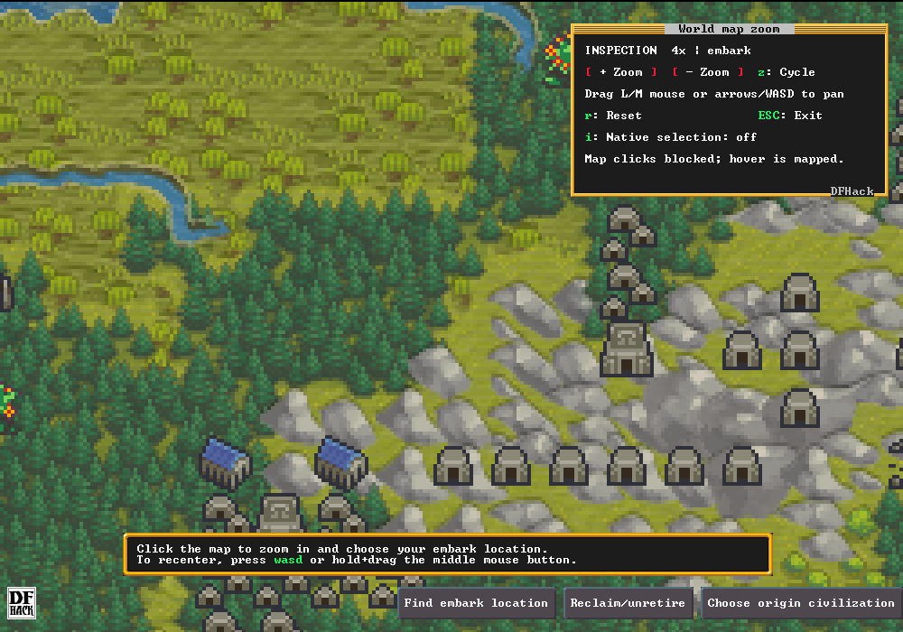

# World Map Zoom 0.3.0

Magnifies the native high-level world map in embark selection and the normal fortress world screen. Supports 1x, 2x, and 4x, pointer-anchored zoom, drag panning, mapped hover, and optional native location selection. Text and surrounding controls retain their native scale. Opening the tool starts at 2x.

Version 0.3.0 adds 4x using the same Direct3D-compatible texture composition introduced in 0.2.1. Close DF before upgrading, then restart it to load the replacement native module.

This build targets **Windows x64, Steam DF 53.16, DFHack 53.16-r3**. The installer checks the exact tested game and DFHack executables. An update requires rebuilding and testing the plugin.

Download **WorldMapZoom-0.3.0-windows-x64.zip** from the
[Releases page](https://github.com/Huitzilopochtli-98/df-world-map-zoom/releases/latest)
and extract the entire ZIP. GitHub's **Code → Download ZIP** and automatic
**Source code** archives contain source only; they require building the plugin.
Verify the ZIP against the release's `SHA256SUMS.txt` with `Get-FileHash` if desired.

Close Dwarf Fortress, open PowerShell in the extracted folder, and run:

```powershell
.\Install.ps1
```

The installer locates Steam's game directory and follows `dfhooks_dfhack.ini` to the separate DFHack directory. For a custom configuration directory, pass `-GamePath`, `-HackPath` (the directory containing `dfhack.dll`), and `-ConfigPath`. The running instance reports these through `dfhack.getDFPath()`, `dfhack.getHackPath()`, and `dfhack.getConfigPath()`.

Open the high-level embark map or the fortress's normal world map. In DFHack's command launcher or console, run:

```text
gui/worldmap-zoom
```

The shorter `worldmap-zoom` command also works.

| Control | Action |
| --- | --- |
| Wheel over the map | Step 1x ↔ 2x ↔ 4x around the pointer; stop at either end |
| Z over the map | Cycle 1x → 2x → 4x → 1x around the pointer |
| + / − buttons | Step zoom around the center |
| Z away from the map | Cycle zoom around the center |
| Arrow keys or WASD | Pan |
| Left or middle mouse drag | Grab and move the map |
| R | Restore the camera from when the tool opened, at 1x |
| I | Toggle native selection; initially off |
| Esc or right-click | Exit zoom |

Inspection blocks map selection and still provides mapped native hover. With native selection on, a short left click selects on release at the inverse-mapped press position. Moving at least six pixels makes it a drag, even if you return to the starting point; a drag never selects. Middle clicks never select. Release outside the map, window focus loss, resize, and exiting the tool cancel a pending selection. Native buttons keep their normal behavior; dragging must start on the map.

Entering the detailed embark map or a native site-action panel closes zoom and restores native rendering. Embarking and issuing orders remain native actions.

Pointer anchoring holds the world point under the mouse until world bounds require a clamp. When the world is smaller than the viewport it stays centered. At 1x DF uses an integral tile camera, so zooming out or panning can snap by up to half a tile (eight map pixels). Magnified crops are accurate to a source pixel. Scales beyond 1x/2x/4x, preference persistence, and other platforms are future work. Detailed geographic maps and the fortress world screen's other modes are not magnified.

To disable from DFHack, run `worldmap-zoom disable`. To uninstall, close DF and run:

```powershell
.\Install.ps1 -Uninstall
```

Existing conflicting files are backed up. Uninstall restores originals and preserves files modified after installation; its recovery record identifies anything preserved. Backups remain in the configuration directory. Game saves and world data are not installer targets.

The native module retains its code until DF exits so queued graphics callbacks cannot execute freed code. Logical unload detaches the hooks. Close DF before replacing the DLL.

Source, tests, compatibility data, captures, and measured results are in the repository. See [technical notes](TECHNICAL.md), [validation](VALIDATION.md), and [compatibility](compatibility.json).




Open source under the permissive [Zlib license](LICENSE). You may modify and
redistribute the mod, including in commercial projects, subject to its notice
requirements. [Contributions and forks](CONTRIBUTING.md) are welcome. Game graphics
remain covered by their owners' rights; see [third-party notices](THIRD_PARTY_NOTICES.md).
This is an independent mod. For build and release steps, see
[technical notes](TECHNICAL.md) and [publishing guide](PUBLISHING.md).
