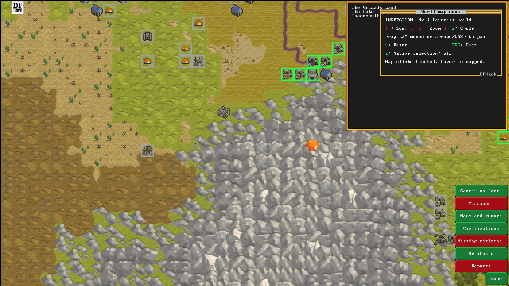

# World Map Zoom 1.0

Make Dwarf Fortress's world map easier to see with **2x and 4x zoom**.
Move around by dragging the map. Hover over places to see their usual information.
Text and buttons stay their normal size.

## What you need

- **Windows 64-bit**
- **Dwarf Fortress 53.16**, Steam version
- **DFHack 53.16-r3**, already installed and working

This download works with those specific versions. The installer checks them
before making changes. Newer game or DFHack versions need a compatible mod build.

## Install

1. **Close Dwarf Fortress completely.**
2. [Download the Windows ZIP](https://github.com/Huitzilopochtli-98/df-world-map-zoom/releases/download/v1.0.0/WorldMapZoom-1.0.0-windows-x64.zip).
   Its name is **WorldMapZoom-1.0.0-windows-x64.zip**. Choose this file,
   rather than one of the "Source code" downloads.
3. Right-click the ZIP, choose **Extract All**, then **Extract**.
   Open the extracted **WorldMapZoom** folder. You should see **Install.ps1**.
4. Click File Explorer's address bar, type **powershell**, and press **Enter**.
   A PowerShell window opens in that folder.
5. Copy this whole line into PowerShell and press **Enter**:

   ```powershell
   powershell -NoProfile -ExecutionPolicy Bypass -File .\Install.ps1
   ```

When you see **Installed World Map Zoom**, installation is finished.
The installer normally finds your Steam game and DFHack folders automatically.
Keep the extracted folder if you want to use its uninstaller later.

## Open the mod in game

1. Start Dwarf Fortress with DFHack running.
2. Open your fortress's **world map**, or the **world map used to choose an embark location**.
3. Press **Ctrl + Shift + D** to open DFHack's command launcher.
4. Type this command and press **Enter**:

   ```text
   gui/worldmap-zoom
   ```

The map starts at **2x zoom**. Run the same command whenever you want to open the mod again.

## Controls

| To do this | Use this |
| --- | --- |
| Zoom in or out | Scroll the mouse wheel over the map, or click **+ / -** |
| Cycle through 1x, 2x, and 4x | Press **Z** |
| Move around | Hold the **left or middle mouse button** and drag the map |
| Move with the keyboard | Press the **arrow keys** or **W, A, S, D** |
| See information about a place | Hover the mouse over it |
| Allow normal map selection | Press **I**; press it again to turn selection off |
| Return to your starting view at 1x | Press **R** |
| Close the mod | Press **Esc** or **right-click** |

When you scroll, the map zooms toward the place under your mouse.
Map selection starts **off** so you can drag without selecting a location.
With selection on, a short left-click selects a location; dragging still moves the map.

The mod works on the main embark world map and the normal fortress world map.
Opening the detailed embark view or a site action panel closes the zoom tool.

## Update or uninstall

**To update:** close Dwarf Fortress, extract the new Windows ZIP, and follow
the installation steps again. You do not need to uninstall the old version first.

**To uninstall:** close Dwarf Fortress. Open PowerShell in the extracted
**WorldMapZoom** folder as described above, then run:

```powershell
powershell -NoProfile -ExecutionPolicy Bypass -File .\Install.ps1 -Uninstall
```

The installer backs up conflicting files. Uninstall restores those backups and
keeps files you changed after installation. Your game saves are left alone.

## If something goes wrong

- **PowerShell cannot find Install.ps1:** open the extracted folder that contains
  that file, then open PowerShell from its address bar. Do not run from inside the ZIP.
- **The installer says the executables differ:** your game or DFHack does not match
  the supported build. Check the versions listed above.
- **The installer says the package is incomplete:** download and extract the
  **Windows ZIP**, not a source-only archive.
- **DFHack does not recognize the command:** check that installation finished
  successfully, restart the game, and make sure DFHack is running.

Still stuck? [Open an issue](https://github.com/Huitzilopochtli-98/df-world-map-zoom/issues).
Include your game, DFHack, and mod versions, plus the error message or a screenshot.

## Steam Workshop

The [Workshop setup companion](https://steamcommunity.com/sharedfiles/filedetails/?id=3828801093)
provides installation help in DFHack. **Subscribing does not install the zoom
feature.** Follow the Windows installation steps above to enable zoom.

## Preview



[See the embark map at 4x zoom](embark-inspection.png).

## Source and license

Version **1.0.0** promotes the tested 0.3.0 implementation to a stable release
with clearer instructions. Zoom behavior and compatibility are unchanged.

The mod is open source under the [Zlib license](LICENSE).
Forks, improvements, and extensions are welcome. See [CONTRIBUTING.md](CONTRIBUTING.md)
to get started. Game graphics belong to their respective owners;
see [third-party notices](THIRD_PARTY_NOTICES.md).

For development details: [technical notes](TECHNICAL.md),
[test results](VALIDATION.md), [changelog](CHANGELOG.md),
and [publishing guide](PUBLISHING.md). The separate
[Workshop companion guide](workshop/PUBLISHING.md) explains its setup-help package.
